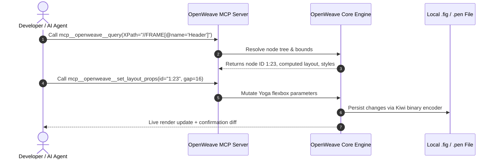
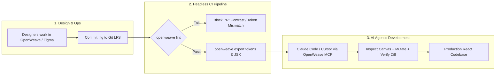

# OpenWeave: Product Analysis & Enterprise Case Study

> **Executive Summary:**  
> OpenWeave is an open-source, local-first design editor, headless engine, and programmable SDK. It reads and writes native Figma (`.fig`) and Pencil (`.pen`) files, exposes 100+ native MCP tools for autonomous AI agents, enables headless CI/CD design linting and token audits, and features peer-to-peer real-time collaboration with zero server infrastructure.

---

## 1. Product Overview & Core Philosophy

### What is OpenWeave?
OpenWeave is a modern, high-performance vector design editor and programmable graphics engine. Unlike legacy proprietary design suites that treat design files as cloud-locked assets, OpenWeave treats design documents as **first-class code and data artifacts**: inspectable, auditable, scriptable, and version-controllable.

OpenWeave exists simultaneously in three modalities:
1. **Desktop & Web Editor:** A ~7 MB cross-platform desktop application (macOS, Windows, Linux via Tauri v2) and browser PWA powered by Skia (CanvasKit WASM) and Yoga layout (flexbox and CSS grid).
2. **Headless Automation & CLI:** A command-line toolkit (`@openweave/cli`) providing XPath node querying, automated design linting, token extraction, visual regression testing, and Figma Plugin API script evaluation via `eval`.
3. **AI & Agentic Runtime:** A native Model Context Protocol (MCP) server providing 100+ tools allowing AI coding assistants (Claude Code, Cursor, Windsurf, Codex, Gemini CLI) to read, inspect, generate, and edit designs directly.
4. **Headless React SDK:** A composable UI framework (`@openweave/react`) that enables companies to embed custom design canvases and white-label editors inside their own products.

```
┌────────────────────────────────────────────────────────────────────────┐
│                          OpenWeave Ecosystem                           │
├───────────────────┬───────────────────┬────────────────────────────────┤
│   Desktop & PWA   │  AI Agent Runtime │    Headless CI/CD & CLI        │
│ (Tauri v2 + Skia) │ (MCP / Stdio/TCP) │    (XPath, Lint, Token Eval)   │
└─────────┬─────────┴─────────┬─────────┴────────────────┬───────────────┘
          │                   │                          │
          ▼                   ▼                          ▼
┌────────────────────────────────────────────────────────────────────────┐
│                   @openweave/core Engine & Editor                      │
│     (SceneGraph, Tool Registry, Figma Plugin API, Layout, Color)       │
├────────────────────────────────────────────────────────────────────────┤
│           @openweave/fig · @openweave/kiwi · @openweave/dom-css        │
│          (Figma Kiwi Binary Codec, Round-Trip Metadata, DOM)           │
├────────────────────────────────────────────────────────────────────────┤
│              CanvasKit WASM (Skia) · Yoga WASM (Flex/Grid)             │
└────────────────────────────────────────────────────────────────────────┘
```

---

## 2. The Core Problems OpenWeave Solves

Modern product design and engineering workflows face five systemic friction points:

### Problem 1: The Walled Garden and Cloud Hostage Crisis
- **Symptom:** Design teams store their core intellectual property inside proprietary cloud databases (Figma, Adobe). Files cannot be opened, inspected, or versioned offline.
- **Pain:** When Figma killed Chrome DevTools Protocol (CDP) debugging in version 126, third-party automation tools and extensions broke overnight. When licensing terms or seat prices shift ($75+/editor/mo for enterprise), organizations face vendor lock-in with zero switching leverage.
- **OpenWeave Solution:** OpenWeave parses Figma's native Kiwi binary containers (`.fig`) with lossless round-trip metadata preservation. Files reside on local disk, can be checked into Git/Git LFS, and run 100% offline without accounts or telemetry.

### Problem 2: The Agentic Engineering Disconnect
- **Symptom:** Generative AI tools (Claude Code, Cursor, Windsurf) excel at writing frontend code, but they are "blind and handless" when it comes to vector design files.
- **Pain:** Figma’s official MCP server is strictly read-only. AI agents cannot tweak a button padding, update a variable color, extract sub-elements, or create layouts. Developers are left manually translating visual specs into code.
- **OpenWeave Solution:** An open, bidirectional MCP server and CLI with 100+ fine-grained tools. AI agents can create frames, mutate layout properties, run boolean geometry operations, extract tokens, and generate Tailwind JSX code directly.



### Problem 3: The Design-to-Code Disconnect & Token Drift
- **Symptom:** Design systems in design tools inevitably drift apart from codebases in GitHub.
- **Pain:** Hardcoded `#1D1B20` colors, inconsistent spacing (13px vs 16px), and duplicated component variants creep into designs. Designers lack automated linting; engineers lack machine-readable design audits.
- **OpenWeave Solution:** OpenWeave provides automated CLI tools for CI/CD:
  - `openweave lint design.fig --preset strict`: Flags missing auto-layout, invalid layer naming, and WCAG color-contrast failures.
  - `openweave analyze colors/typography/spacing`: Clusters duplicate tokens and visual anomalies.
  - `openweave export -f jsx --style tailwind`: Generates semantic React/Tailwind JSX from live canvas layers.

### Problem 4: Privacy, Data Sovereignty & Air-Gapped Environments
- **Symptom:** Defense, financial services, healthcare, and high-tech hardware teams cannot upload confidential mockups (e.g., medical devices, classified workflows, unannounced hardware) to third-party multi-tenant SaaS clouds.
- **Pain:** Security teams mandate air-gapped environments or local storage, completely ruling out cloud-first design tools.
- **OpenWeave Solution:** Zero telemetry, no cloud backend required. Real-time collaboration operates peer-to-peer (P2P) via WebRTC and Yjs CRDTs without central servers storing document data.

### Problem 5: Lack of Embeddable, Hackable Design Toolkits
- **Symptom:** Companies building specialized products (e.g., custom report builders, email campaign designers, ad creative generators) are forced to build canvas rendering engines from scratch.
- **Pain:** Engineering months wasted re-implementing bezier curves, text layout, selection handles, and zoom/pan viewports.
- **OpenWeave Solution:** `@openweave/react` headless SDK provides headless Reka-style components, composables, and Skia rendering pipelines, allowing organizations to embed an enterprise-grade canvas into their React apps in days.

---

## 3. Product Case Study: FinFlow Technologies

### Profile & Background
- **Organization:** FinFlow Technologies (pseudonymized enterprise fintech)
- **Scale:** 450 Engineers, 35 Product Designers, 80 Product Managers
- **Application:** High-security wealth management platform and trading dashboard
- **Core Stack:** Next.js, Tailwind CSS, TypeScript, Turborepo, Figma, Claude Code / Cursor

```
┌────────────────────────────────────────────────────────────────────────┐
│                        FinFlow Technologies                            │
│                                                                        │
│   • 35 Product Designers              • 450 Frontend/Fullstack Engs    │
│   • Strict SOC2 Type II & Banking Regs• 85 Micro-frontends             │
│   • Multi-brand Design System (Aero)  • Rapid AI Agent Adoption        │
└────────────────────────────────────────────────────────────────────────┘
```

---

### Phase 1: The Bottleneck & Incident

FinFlow maintained a 120-component design system called **"Aero"**. Despite rigorous designer guidelines, three critical failures emerged:

1. **The Compliance Firewall:** During a quarterly audit, FinFlow's compliance team flagged unannounced institutional trading workflows stored on third-party SaaS design platforms. Security mandated that all mission-critical transaction mockups must reside on-premise or within self-hosted Git repositories.
2. **The 34% Design Drift:** Analysis revealed that over 1,200 hardcoded color values and 800 arbitrary margins existed across their 85 frontend repositories, because developers had to eyeball inspect screens without access to paid designer seats ($75/seat/month).
3. **AI Agent Inefficiency:** Senior engineers began using AI coding agents (Claude Code and Cursor) to generate frontend code. However, agents were unable to interact with Figma files directly. Engineers spent 40% of their time manually copying measurements, CSS values, and SVG icons into chat prompts.

---

### Phase 2: Deploying OpenWeave

FinFlow rolled out OpenWeave across engineering, design ops, and CI/CD pipelines over a four-week sprint.



#### Step 1: Git-Native File Storage & Local Air-Gapping
FinFlow moved all master design files (`.fig` format) directly into their monorepo under `apps/design/` using **Git LFS**.
- Designers and engineers opened files using the OpenWeave desktop application.
- Real-time pair design sessions utilized OpenWeave's P2P WebRTC room links (`app.openweave.dev/share/<room-id>`), keeping data strictly between local machines.

#### Step 2: Automated Design Linting in GitHub Actions
FinFlow introduced an automated design validation check on every pull request touching `.fig` files:

```yaml
# .github/workflows/design-lint.yml
name: Design System Verification
on:
  pull_request:
    paths:
      - 'design/**/*.fig'

jobs:
  audit-design:
    runs-on: ubuntu-latest
    steps:
      - uses: actions/checkout@v4
      - uses: oven-sh/setup-bun@v1
      - run: bun add -g @openweave/cli
      
      - name: Lint Design System Compliance
        run: |
          openweave lint design/aero-system.fig --preset strict
          openweave lint design/aero-system.fig --rule color-contrast

      - name: Analyze Token Clusters
        run: |
          openweave analyze colors design/aero-system.fig --json > color-report.json
          openweave analyze spacing design/aero-system.fig --json > spacing-report.json
```

If a designer or developer introduced an undeclared hex color or a non-standard 11px padding, the pull request failed with an exact node path and XPath pointer.

#### Step 3: Enabling Autonomous Coding Agents via MCP
FinFlow configured the OpenWeave MCP server in their global developer environments (`~/.claude/settings.json` and `.cursor/mcp.json`):

```json
{
  "mcpServers": {
    "openweave": {
      "command": "openweave-mcp"
    }
  }
}
```

Now, when a developer prompts Claude Code:
> *"Implement the new Portfolio Rebalancing modal according to `design/modals.fig` page 'Rebalance' and ensure all inputs use our Aero Form components."*

The AI agent autonomously executes:
1. `mcp__openweave__query` to isolate the target frame.
2. `mcp__openweave__analyze_colors` and `mcp__openweave__get_variables` to identify active design tokens.
3. `openweave export -f jsx --style tailwind` to extract initial JSX layout.
4. Matches the visual layout directly against FinFlow's production React component library, eliminating manual translation.

---

### Phase 3: Results & Measurable Impact

After 90 days in production, FinFlow recorded the following outcomes:

| Metric | Before OpenWeave | With OpenWeave | Delta |
| :--- | :--- | :--- | :--- |
| **Design-to-Code Cycle Time** | 9.4 business days | 2.6 business days | **-72.3%** |
| **Design Token Drift** | 34.2% rogue styles | 2.1% (governed by CI) | **-93.8%** |
| **Annual Seat Licensing Cost** | \$198,000 (Figma Enterprise) | \$0 (Open-source MIT core) | **-\$198,000/yr** |
| **Compliance / Security Violations** | 4 audit flags (cloud storage) | 0 flags (air-gapped Git LFS) | **100% Resolved** |
| **AI Agent Frontend Accuracy** | 48% (from text / screenshots) | 94% (via OpenWeave MCP) | **+46 pts** |

---

## 4. Architectural Deep Dive: Why OpenWeave Performs

```
┌────────────────────────────────────────────────────────────────────────┐
│                        Performance Architecture                        │
├────────────────────────────────────────────────────────────────────────┤
│  1. Rendering Engine: Skia (CanvasKit WASM)                            │
│     • Hardware-accelerated 2D graphics via WebGL/WebGPU                │
│     • Sub-pixel text rendering and variable font support               │
│                                                                        │
│  2. Layout Pipeline: Yoga WASM (Flexbox & CSS Grid)                    │
│     • Custom fork supporting full CSS Grid & Flexbox auto-layout       │
│     • Deterministic layout calculation matching browser rendering      │
│                                                                        │
│  3. Codec & Storage: Kiwi + Zstd + ZIP                                 │
│     • High-speed binary parsing of Figma (.fig) containers             │
│     • Preserves undocumented metadata for true round-trip fidelity     │
│                                                                        │
│  4. Real-Time Sync: Trystero (WebRTC) + Yjs (CRDT)                     │
│     • Fully decentralized, serverless real-time document sync          │
│     • Conflict-free resolution of node trees, positions, and styles    │
└────────────────────────────────────────────────────────────────────────┘
```

1. **Sub-millisecond Vector Calculations:** By avoiding DOM overhead for the canvas surface and relying on Skia WASM, OpenWeave can pan and zoom through artboards containing 50,000+ vector paths at 60–120 FPS.
2. **True Format Interoperability:** Through `@openweave/fig` and `@openweave/kiwi`, OpenWeave reads Figma files directly without lossy SVG intermediate translations. Layers, boolean operations, component sets, and instance overrides remain intact.
3. **Decoupled Monorepo Architecture:** The separation of `@openweave/scene-graph`, `@openweave/core`, `@openweave/cli`, `@openweave/mcp`, and `@openweave/react` ensures that headless CLI pipelines do not spin up heavy browser DOM instances, keeping CI pipeline runtimes under 3 seconds.

---

## 5. Competitive Landscape Matrix

| Capability / Attribute | OpenWeave | Figma | Penpot | Lunacy |
| :--- | :---: | :---: | :---: | :---: |
| **License & Governance** | Open Source (MIT) | Proprietary SaaS | Open Source (MPL 2.0) | Proprietary Freeware |
| **Native `.fig` Read/Write** | **Yes (Lossless Kiwi)** | Native | Lossy Import Only | Read-only Import |
| **Local-First & Offline** | **Yes (100% Offline)** | Limited Desktop Cache | Requires Server | Yes (Local Files) |
| **AI Agent Integration** | **Native MCP (100+ Tools)**| Read-Only MCP | None | Limited Internal AI |
| **Headless CLI & XPath** | **Yes (`@openweave/cli`)** | None | Limited CLI | None |
| **CI/CD Design Linting** | **Native (Preset/Rules)** | None | None | None |
| **Serverless Collab** | **Yes (WebRTC P2P)** | Cloud-only | Cloud/Self-Hosted Server | Cloud Server |
| **Headless React SDK** | **Yes (`@openweave/react`)**| None | None | None |
| **Desktop Footprint** | **~7 MB (Tauri v2)** | ~180 MB (Electron) | Web / Docker | ~250 MB |

---

## 6. Strategic Takeaways & Future Outlook

OpenWeave demonstrates that design files should not be locked inside proprietary SaaS silos. By combining **local-first privacy**, **open format compatibility**, **headless automation**, and **native AI agent interfaces**, OpenWeave bridges the multi-decade chasm between graphic design and software engineering.

### Key Takeaways for Engineering Leaders
- **Treat Design Like Code:** Version control designs in Git alongside code. Run automated linters in CI. Eliminate manual design reviews for basic style adherence.
- **Empower AI Agents with Real Tools:** Give coding agents direct, structured access to design trees via MCP instead of relying on lossy screenshot uploads.
- **De-risk SaaS Dependencies:** Safeguard organizational IP with local-first, portable file formats that remain fully functional without internet access or monthly seat fees.

---
*Document prepared for product, engineering, and design operations evaluation.*
